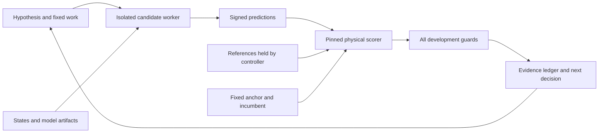

# Signed-increment research contract

## Responsibility

Keep the scientific mission, fixed physical evaluator, evidence and execution
authority separate from candidate methods. Start here when continuing research.
This directory does not replace historical experiments or production training.

The reference-to-worker path is absent. A development pass does not open the
confirmation set or replace production automatically.

## Startup and completion

1. Read `CHARTER.md`, `EVALUATION.md`, `OPERATING_PROTOCOL.md` and `status.json`.
2. Read `campaign.json` and the active experiment. Check actual jobs before launch.
3. Validate bound data, anchor, evaluator and source hashes. Reproduce saved scores.
4. Admit GPU work only within an authorized allocation and verified isolation.
5. Score physical predictions independently. Archive every result, then update the
   evidence ledger and status. A completed negative experiment is not a model gain.

Contract installation and real-array scorer parity are complete. Read `status.json`
for the current experiment and evidence links.
The owner authorized execution and removed aggregate/time caps on 2026-10-13.
Use one idle GPU and finite declared work per experiment. If contention appears,
stop only our work, then wait or report. Candidate training still requires runtime
bindings and evaluator isolation to pass admission. The bases remain incumbents.

## Inputs, outputs and boundaries

`campaign.json` owns the prospective numerical gates and resource envelope.
`bindings.json` pins existing data and baseline identities; it contains relative
project paths, not private labels or credentials. `status.json` is a restart index.
`evidence.jsonl` is append-only historical evidence. Experiment manifests live in
`experiments/`; large runtime state, arrays and logs remain under ignored `runs/`.

The supplied starter kit is a proposal, not evidence of installed enforcement.
Its charter/evaluation/protocol are imported with provenance in `import.json`.
The original JSON had an ambiguous total/per-fit task limit. The owner's later
instruction removes those caps; `campaign.json` records the actual authority.
No paid agent API jobs or confirmation access are authorized by this import.

## Dependencies and verification

`benchmarks.research_contract` owns deterministic scoring, alignment checks and
admission. It reuses the historical checked readers. Candidate code consumes the
contract; it cannot redefine it. GitHub is a review view, not an evaluation input.

Example: `python -m benchmarks.research_contract.replay --help`.
Run `python -m pytest tests/test_research_contract*.py -q`.
Expected: synthetic scoring, fail-closed gates and identity tests pass. The server
replay must reproduce historical counts before a new candidate can be evaluated.

Mechanical access isolation needs a verified runtime boundary. Same-account hashes
and a separate Python process detect mistakes; they are not a security boundary.
Record the actual boundary and keep confirmation disabled until custody exists.
