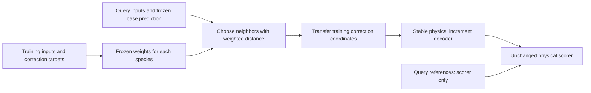

# Signed-increment research results

## October14: reaction structure and affinity implementation

Registered `EXP-20261014-reaction-attention`: fixed stoichiometric pooling versus
small two-head cross-attention, each without/with reaction affinity. The same
frozen bases and physical contract apply. This is a factorial architecture/input
test, not an LLM or a hard thermodynamic guarantee. Implementation and prechecks
do not establish improved accuracy. See the module README and experiment manifest.

Implementation is complete; training has **not started**. Seven new module tests
and real-mechanism zero-head checks pass. The existing protected sandbox cannot
initialize idle nonzero-index GPUs because it retains the host CUDA index after
restricting device mounts. Diagnostic UUID selection succeeds with the same mounts.
No protected file or lock was changed. See the experiment preflight note for the
reproducer, verification limits and required owner-controlled infrastructure repair.

The preceding interval-readout trial is complete and rejected. Development
acceptance was67.03/67.44% for point supervision and64.45/64.78% for interval
supervision, versus68.30/68.80% for the base. Its four fits, state-only replay,
protected scores and independent reconstruction were verified; the supplement
checked loss denominators and raw logits. An interval objective did not preserve
base successes in this affine recipe. This is not a proof against every interval
method. Review `fd324636a74191eacfea254087fdbf09afa0124f4bc60e36813f04835b504d43`;
supplement `bd4fb4f3dab6b0844f8d384a4f5be205265e8c869f9346465fb1d6d42cab331b`.

## Latest: strict consensus meets the current development gates

The checked GPU implementation is **development-qualified, pending supervisor
promotion and independent confirmation**. The incumbent remains continued GBCT.

| Population | Base11 /12 | Candidate11 /12 |
|---|---:|---:|
| Same-source unseen20k | 72.241 /72.275% | 72.788 /72.816% |
| Development1023 | 68.296 /68.800% | 68.901 /69.414% |

All protected physical gates pass. Development repairs518 /516 components and
damages159 /152; damage is0.392 /0.372% of base successes. No new sign errors,
severe events or negative endpoints occur. Total latency is1.21-1.25x the
historical anchor, below1.5x. It is1.70-1.73x an equally optimized single base:
the cost qualification depends on the current implementation comparator.

The GPU inverse has less than9e-12 allowance units of numerical drift and changes
zero pass decisions. Twenty focused tests, exact replay, independent full counts
and separate source review passed. Review found an invalid-input rejection gap;
the checked revision fixes it and repeats inference/timing in a new directory.
The old results remain intact. Checked review:
`1ab4e738c79e8eb9f08aa233a6d457ef01dbf59dd566ad648dde2d03ae952244`.

This is a small one-step development gain, not the main research objective
solved. The rule cannot fix wrong signs or severe errors. Both directions share
one base pair, and the development sets have been used repeatedly.

The follow-up species/disagreement table is closed: out-of-fold gains were only
0.026 /0.026 percentage points, below the registered0.5-point gate. Always taking
the smaller same-sign prediction damaged about7.1% of base successes. Independent
table-eligibility and prediction recount passed. No bins were tuned afterward.

The matched-work representation comparison is complete. On common training50k,
GBCT/signed-power means reach71.90 /71.54%, below two-GBCT means73.63% and with
excess damage. Strict signed-power pairs slightly beat the same-rule seed control,
but remain below the continued anchor. No mixed pair qualifies. Independent
overlap, oracle-union and correlation recount passed. The seed control also has
different training/calibration samples; it is not pure initialization diversity.
Review: `653e14e0c3f57bec3ff7e1874ed2382a627dffe8eca90160753d4f96959bba35`.

The input-rounding audit found no incompatible GBCT output intervals in32
constructed local pairs (1856 qualified paired components). All64 five-check
reference calculations completed. Maximum increment change was0.000032 of an
allowance. Exact effective composition, input collision and independent inverse
boundaries passed. This small sample does not prove FP32 harmless everywhere,
but gives no support for this explanation of the observed fitting failures.

Next: freeze the base features and compare an affine GBCT output readout trained
on exact targets versus acceptable intervals. The interval arm leaves already
acceptable outputs alone in its objective. Both use the same50k states, scales,
initialization and work. This is not the earlier nonlinear asinh correction.

## Previous: teacher compression does not retain the gain

The small head is **valid negative**, not a new incumbent. It costs1.37-1.40x
the base, within the1.5x runtime limit, but gains only0.002 /0.017 percentage
points on U. Development changes are+0.008 /-0.027 points. A per-species constant
teacher fraction performs similarly. The head does not consistently beat it.

Both6000-update fits completed. Exact state-only replay, independent physical
recounts, and a separate source review passed. The bounded decoder prevents new
sign reversals and magnitude growth, but cannot make an inaccurate teacher
approximation useful. Each head trained on the same common50k states, excluding
both U sets. No confirmation data was used and no candidate was promoted.

Next: test the cost of the verified two-base rule with shared input preparation
and GPU reconstruction. This is an implementation test, not a larger head or
another loss. Measure arithmetic differences and all physical gates again.

## Previous: strict consensus passes physical gates, but is too slow

The strict interval retains base signs and limits magnitude growth. Fresh
isolated replay passes **every physical gate** on fullU20k andD1023 for both
anchor directions. The result is still **accuracy-only / trade-off**.

| Population | Continued base11 /12 | Strict consensus11 /12 |
|---|---:|---:|
| Same-source unseen20k | 72.241 /72.275% | 72.788 /72.816% |
| Development1023 | 68.296 /68.800% | 68.901 /69.414% |

Development repairs518 /516 and damages159 /152 components. Damage is0.392 /
0.372% of base successes. No added sign errors, severe events or negative
endpoints occur. Total inference costs2.18-2.22x, above the unchanged1.5x guard.
No incumbent is replaced. Review:
`46905c6683b5eb26de706569a0c9d35d9ced75c551dd0ac88bc03217017f8a24`.

This method can only repair near-threshold failures. It retains existing wrong
signs and does not solve severe magnitude errors. Its two directions share one
base pair; no independent confirmation or ensemble replication is claimed.

The intermediate zero-inclusive restriction was also retained: it gained
0.55-0.62pp but added wrong-sign counts by returning zero. Changing to[b,0.9b]
was a new declared prediction rule, not a scorer change or silent repair.
Forty-three focused tests and separate source/math review passed.

Next: compress the teacher's bounded adjustment into a small head on one frozen
base's800 hidden features. Compare with a training-derived constant fraction.
The physical gates and complete inference-cost requirement remain unchanged.

## Previous: bounded consensus gain transfers, but two guards fail

Fresh state-only inference confirms a gain beyond the candidate diagnostic rows.
The fixed bounded midpoint is **trade-off only**, not a new incumbent.

| Population | Base, seed11 /12 | Bounded consensus, anchor11 /12 |
|---|---:|---:|
| Same-source unseen20k | 72.241 /72.275% | 73.255 /73.292% |
| Development1023 | 68.296 /68.800% | 69.439 /69.825% |

Development repairs988 /923 components and damages310 /315. Damage is0.765 /
0.772% of prior successes. All four populations return zero negative endpoints.
However, seed11 U has55 severe events at epsilon1e-9/eta1e-8 versus54 before.
The complete two-model inference costs2.14-2.16x; the limit remains1.5x.
Neither a small event increase nor excess runtime is waived.

The bound can repair only errors up to E=1.11111 in exact arithmetic. This is
a near-threshold repair result, not a solution for severe magnitude errors.
Both anchor directions use one overlapping pair, not independent ensemble
replications. No confirmation data was opened. Review:
`373b230b45bb097f8ad38e8157434d4fa78127c7c94302470634e0e57d3fb0db`.

Exact reload/replay, protected full scores and independent counts passed. The
first review stopped because44 /38 U rows have no counterpart in the other
seed's prepared training cache. Review now records parity on the overlapping
rows and full fresh replay on all rows; **no scored row was dropped**. Cache
absence does not prove absence from all earlier calibration exposure. A test
command named a nonexistent adapter test; the corrected41-test run passed on
both local and server environments before inference.

Next: one declared restriction that cannot increase anchor magnitude or reverse
its sign. It has a general severe-event protection property, but can lose useful
repairs. Check that trade-off before any speed optimization or new fit.

## Previous: two-base averaging has a repair signal, but fails preservation

On one aligned common20k training-pool population, the physical mean reaches
**75.450%**, versus **72.202% / 72.323%** for its two input bases. The asinh
mean reaches75.321%. This is one pair of models, not two independent repeats.

The physical mean repairs85,404 /84,252 components but damages47,728 /47,974
against the respective bases. Damage is5.70 /5.72%, above the2% guard. It has
zero negative endpoints but increases some severe-event counts. The asinh mean
has60 negative endpoints. Neither is qualified, and latency was not measured.

The bases both pass725,764 of1,160,000 components; exactly one passes224,966;
both fail209,270. Their signed asinh-error correlation is0.670 overall, not a
physical-error correlation or proof of systematic bias. The oracle union is
descriptive, not an inference policy. Independent categorical recount verified
the overlap and repair identities. Review:
`a20c10418806ae3c84a31c70102d180e188ca7b94a727142a82a215f65ce0cb1`.

Next is one fixed bounded midpoint adjustment. It limits prediction movement
without changing the physical allowance. No weight or bound scan is authorized
by this trial. Cached arithmetic still requires later isolated replay and cost
measurement before it could qualify as a predictor.

## Previous: conservation projection is not an accuracy solution

The no-fit projection test is **valid negative**. Amplitude weighting raises
check acceptance by only 0.035 / 0.019 percentage points. It returns 4,456 /
4,289 negative endpoints and costs 142 / 147 times the base in this SVD
implementation. Uniform weighting reduces acceptance to 33.35 / 33.32%.

Both projections remove nearly all elemental imbalance, but that does not
establish correct species increments. The amplitude version repairs 9,389 /
9,006 components and damages 8,978 / 8,784. No rank fallback occurred. The
unchanged accuracy and validity gates fail. Do not optimize this implementation
for speed before there is a useful accuracy result.

Exact state-only replay, independent CPU formula samples, inactive-AR checks
and the full protected physical recount passed. The review initially stopped
on a NumPy-integer/Cantera API mismatch; the native-index fix did not change
predictions or the scorer. Review:
`03e255e1172835f7a50c4b8531f3d36801017ed4ab9d2e8f87a790d7f4ebc15e`.

These are inherited training-pool diagnostic populations; no projection was
fitted and no independent confirmation was opened. GBCT remains the incumbent.
Next: compare aligned errors of the two frozen bases. This tests whether their
remaining errors contain useful cancelling variation before another fit.

## Previous: species-specific heads do not improve transfer

The four-fit parameter-sharing test is **valid negative**. Independent species
heads fit about as well as a nearly equal-size shared head, but damage more
unseen predictions. This does not establish a gradient-conflict mechanism.

| Head | Fitting20k acceptance | Check20k acceptance |
|---|---:|---:|
| Shared,285270 parameters | 73.076 / 73.347% | 68.310 / 68.377% |
| Species-specific,285882 parameters | 73.044 / 73.393% | 67.251 / 67.476% |
| Continued GBCT | 72.214 / 72.511% | 72.242 / 72.267% |

Species heads repair42,022 /42,158 check components but damage99,922 /97,729.
Both methods exceed the1.5x latency guard. Eighteen focused tests, separate source
review, exact state-only replay, independent forward samples and full physical
recount passed. Review: `ad0f77c14d381ab1805471a1c8038291f48f19952817fb0da02078dc6d48a91f`.
No promotion. Stop head-capacity changes from this result. Next test uses fixed
element conservation constraints, not another learned generic correction.

## Previous: kinetic features do not provide a transferable gain

Six matched fits are complete and independently recounted. **Valid negative.**
Initial-rate features improve training slightly, but still damage unseen rows.

| Input/head | Fitting20k acceptance | Check20k acceptance |
|---|---:|---:|
| Continued GBCT | 72.214 / 72.511% | 72.242 / 72.267% |
| Ordinary features | 72.071 / 72.373% | 70.487 / 70.561% |
| Added kinetic features | 72.355 / 72.644% | 70.531 / 70.387% |
| Near-equal-parameter control | 72.185 / 72.477% | 70.251 / 70.305% |

The kinetic arm repairs28,050 /28,433 base failures but damages47,900 /50,237
base successes on check. It returns16,012 /16,808 negative endpoints. Live
inference, including CPU kinetics, costs15.67 /18.78 times the anchor. No
candidate advances. These are training-pool diagnostic rows, not protected U/D.

Raw Euler and frozen-exponential estimates pass only16.88 /16.92% and28.65 /
28.71% on check. Their use as features is not a numerical reference or new
physical information. Forty-two focused tests, separate source review, state-only
saved replay and independent row/scaler/rate/count checks passed. Review:
`34325bdcbe69d841f0107d6a959f011fb121f6222534184b10e17b6deed036d1`.
Next: inspect fixed raw-rate/base-pass overlap before selecting another fit.

## Previous: nonlinear selection also gives no gain

The second selector test is **valid negative**. Both seeds select the calibrated
always-base threshold (1.01), with zero repairs and zero damage. Check acceptance
is therefore unchanged at 72.242 / 72.267%. The 20k check rows are training-pool
diagnostics, not the protected U20k or independent confirmation.

Close this selector family provisionally. More gate capacity did not establish
transferable selection under the registered work. This does not prove that all
learned selection is impossible. Saved replay, independent calibration/count
reconstruction and protected physical scoring passed. Review:
`b550eab3491a869f72f066cb6d71654505bb887f562d9af552d60201e7bb3a6b`.

Next: test initial kinetic-rate features against existing inputs and a nearly
parameter-matched capacity control. This adds mechanism computation, not new
reference information. It is an accuracy diagnostic with explicit inference cost.
The continued GBCT models remain the incumbents.

## Previous: affine correction selection gives no net repair

The registered training-only check is **valid negative**. Its affine selector
returns the base's exact acceptance on both20k check sets:72.242 /72.267%.
Seed11 repairs/damages0/0 components; seed12 repairs/damages2/2. The
species-intercept control selects the base everywhere. The raw frozen correction
has only66.177 /66.020% acceptance on these same rows.

The calibrated affine thresholds are0.94 /0.92. Even without calibration
constraints, the best registered threshold gains only one component on each
10k calibration set. Thus the tested affine score does not separate enough
useful corrections; the preservation constraint alone does not explain failure.
These are correction-unseen training-pool rows, **not the protected U20k**.
Ten tests, separate source review, exact reload and frozen-prediction replay,
protected scoring and independent split/count/selection checks passed. Review:
`c0a02ade3486e9359229168262a7330e49c5539bb04c6321bd195a3e288ed5c7`.

Next: one [nonlinear selector control](experiments/EXP-20261013-selective-nonlinear.json)
with the same inputs, rows and work. It tests interactions/function capacity,
not a new correction or relaxed criterion. Close this recipe if it also fails.

## Latest diagnostic: output-bin calibration does not transfer

**Valid negative.** In two-fold checks within the50k training pool,16
base-output bins per species lose0.038 /0.040 percentage points versus the
base. They repair26,661 /24,884 components but damage27,765 /26,041.
They also create26,878 /36,750 negative endpoints. A matched constant control
is less harmful, but does not improve on the base either. Close scalar-bias
calibration provisionally. These are training-pool cross-fit results, not U/D
scores or independent confirmation.

Both folds use fit-only edges and shifts; query labels do not enter prediction.
Twelve focused tests, separate source review, artifact-only replay and independent
physical recount passed. Review hash:
`2f3c474dd9e51968bb082a71b0771c87f0bacee283e58ab2479b190f56c8b6da`.

The next unresolved question is whether useful corrections can be selected
from permitted features while retaining the base elsewhere. This is different
from changing correction amplitude: prior global damping failed. Any learned
selector must be fitted and calibrated on rows not used to train its frozen
correction, and checked on a third disjoint training-pool subset before U/D.

## Latest: broader support does not rescue base continuation

**Valid negative result. The continued GBCT incumbent is unchanged.** The
180k-state control reduces same-source damage compared with the50k averaged
arm, but does not improve on the base in either seed. Development changes
remain small and disagree in sign. No negative endpoints were returned.

| Predictor | Same-source unseen,20k | Development,1,023 |
|---|---:|---:|
| 180k update support | 72.214 / 72.260% | 68.330 / 68.787% |
| 50k averaged control | 72.188 / 72.231% | 68.298 / 68.826% |
| Continued GBCT | 72.241 / 72.275% | 68.296 / 68.800% |

The180k training acceptance is72.253 /72.341%, versus its own base72.230 /
72.320%. This population differs from the historical50k training score. Both
fits use30M row presentations and3,000 updates, not equal epochs. Exact saved
replay, fresh base replay and independent full-population recount passed.
Review hash: `68dd5c05db2827841dd34e53c743d89e001e0334cac982a1d1fbeb9c2d8b5c23`.
Close this low-step continuation family provisionally; no more LR/batch sweep.

The following training-only [conditional scalar-bias check](experiments/EXP-20261013-conditional-calibration.json) is now complete (above).
Two-fold evaluation compares one species constant with16 training-derived
base-output bins. It tests repeatable output-dependent bias, not a new loss or
another large network. It does not open development or confirmation data.

## Previous model test: low-step base continuation

**Valid negative result. Neither batch size qualifies.** Training acceptance
improves by about 0.06-0.10 percentage points, but same-source unseen acceptance
falls. Development changes are tiny. No negative endpoints were returned;
latency stayed close to the anchor. The accuracy gain requirement still fails,
and seed 11 also fails weak-tail and sign guards.

| Predictor | Same-source unseen, 20k | Development, 1,023 |
|---|---:|---:|
| 1k gradient batch | 72.22 / 72.26% | 68.30 / 68.83% |
| 10k averaged gradient batch | 72.19 / 72.23% | 68.30 / 68.83% |
| Continued GBCT | 72.24 / 72.27% | 68.30 / 68.80% |

Both arms received 3,000 updates, but 3M versus 30M row presentations. More
averaging improved fitting, not transfer. Exact replay, independent recount,
and the unchanged gate checks passed. The incumbent did not change.
See the [aggregate scorecard](results/base-polish-20261013.json).

The completed [fitting-support control](experiments/EXP-20261013-base-support.json)
tested the following:
use all 180k existing non-evaluation states instead of narrowing updates to50k.
Keep the 10k batch, update count, schedule, preprocessing and full U/D evaluator.
This tests a specific possible source of regression, not a resumed data ladder.

## Previous diagnostic: finite base-update size

On 16 independent training-batch probes, fresh Adam at 1e-6 reduced predicted
first-order pass and fail losses, but damaged acceptance on all 16 separate
check batches. At 1e-7, actual fitting loss decreased in all 16 probes. Check
acceptance improved in 11, fell in 4, and tied in 1. The seed-level effects
remain mixed. At 1e-8, changes are smaller, without a clear balanced result.

These are **training-only, single-step diagnostics**, not a new predictor or
development result. Each probe restores the original model. Do not combine
their predictions as if they came from one trained candidate. The
[count summary](results/base-step-diagnostics-20261013.json) and immutable
reviews retain those distinctions. Decoder parity and independent recounts
passed. No PCGrad benefit is established.

The completed next diagnostic averaged gradients over seven non-check batches at fixed1e-7. This
registered [gradient-support diagnostic](experiments/EXP-20261013-gradient-average.json)
separates minibatch variability from step size. No further step-size sweep.

## Previous: species-constant calibration

**Valid negative result. The continued GBCT base remains the incumbent.**
Physical-interval consensus improves training acceptance by only 0.047 / 0.052
percentage points. These small gains do not transfer. Coordinate Smooth L1
does not provide a useful calibration either. Both methods create additional
negative endpoints and fail the unchanged qualification gates.

| Predictor | Same-source unseen, 20k | Development, 1,023 |
|---|---:|---:|
| Constant coordinate Smooth L1 | 72.22 / 72.27% | 68.33 / 68.74% |
| Constant interval consensus | 72.23 / 72.27% | 68.30 / 68.73% |
| Continued GBCT | 72.24 / 72.27% | 68.30 / 68.80% |

The [aggregate evidence](results/interval-calibration-20261013.json) records the
counts and rejected gates. State-only replay, independent physical recount,
and exact frozen-base replay passed. This closes the global-shift explanation
provisionally. It does not rule out a useful input-dependent model.

The subsequent [training-only parameter-gradient probe](experiments/EXP-20261013-gradient-probe.json)
of the continued base. Measure actual Adam-step repairs and damage before
choosing another optimizer or parameter-sharing intervention. No new candidate
or independent-confirmation claim is made.

## Previous: full-data coefficient refinement

**Valid negative result. More accurate fitting of this coordinate objective did
not improve the physical predictor.** The protected scorer and separate recount
reject both arms. Continued GBCT remains the incumbent.

The [aggregate scorecard](results/local-optimum-20261013.json) contains the full
population counts, repair/damage, tails, latency, gate failures and snapshot cuts.

| Predictor | Same-source unseen, 20k | Development, 1,023 |
|---|---:|---:|
| Global basis, after 20 full-data updates | 71.72 / 71.80% | 67.90 / 68.17% |
| Species basis, after 20 full-data updates | 71.11 / 71.31% | 67.44 / 67.75% |
| Continued GBCT | 72.24 / 72.27% | 68.30 / 68.80% |

The basis, labels, loss and decoder did not change. All four objectives decreased,
by about 0.10-0.16%, while training and unseen physical acceptance decreased.
This is extra optimization after Adam, not equal-work evidence. Four refinements
used 48.7 seconds of recorded fit time, excluding staging, replay and scoring.

The recorded gradient is per-species, not the gradient of the globally averaged
loss. With ridge curvature `mu=2e-6/128`, the conservative strong-convexity bound
`128 * max_gradient^2 / (2*mu)` is about 1.4e-5 / 1.0e-5 for the global arms and
1.3e-3 / 1.7e-4 for the species arms. These are computed-gradient bounds for the
FP64 fixed-design objective, not formal floating-point certificates or bounds
on acceptance. Twenty steps alone do not prove an exact optimum.

Close this fixed-basis recipe provisionally. The next diagnostic removes neural
optimization and input-dependent transfer entirely: compare two ways to fit one
constant per species, coordinate Smooth L1 versus physical-interval consensus.
It asks whether the fitting criterion chooses useful, transferable calibration.
No reference-dependent inference or temperature switch is added. See the
[prospective manifest](experiments/EXP-20261013-interval-calibration.json).

## Previous: trained fixed-centre local functions

**Valid negative result. GBCT remains the incumbent.** Both distances used the
same 128 centres, 7,424 learned coefficients, 50k training states and work budget.
Unlike the earlier neighbor diagnostic, these models use fixed learned weights
at inference, with no reference-library lookup.
The [aggregate scorecard](results/local-function-20261013.json) preserves the
full comparisons and damage slices without publishing private prediction arrays.

| Predictor | Same-source unseen, 20k | Development, 1,023 |
|---|---:|---:|
| Global-distance local correction | 72.03 / 72.10% | 68.16 / 68.50% |
| Species-distance local correction | 71.49 / 71.62% | 67.81 / 68.06% |
| Continued GBCT | 72.24 / 72.27% | 68.30 / 68.80% |

Values are seed 11 / 12. Species distance did **not** beat global distance here.
On development it repaired 1,081 / 962 base failures, but damaged 1,370 / 1,401
base successes. The global model repaired 585 / 547 and damaged 665 / 728.
Both models introduce negative endpoints and take about 2.41-2.50 times measured
base latency. Neither qualifies. Full nominal-label scoring, state-only replay,
fresh base replay, tail/count/gate recounts and snapshot damage checks passed.
No confirmation data was opened. The four fits used about 55 seconds of recorded
fit time; this is not GPU allocation time.

The neighbor result cannot be treated as a guarantee for a trained local model.
The next registered control keeps this basis and objective fixed and uses 20
full-data convex coefficient updates. It asks whether Adam left useful fitting
work undone. It is additional optimization, not a matched-work architecture test.
See [the experiment](experiments/EXP-20261013-local-optimum.json) and the ledger.

## Previous: species-specific distance diagnostic

**Result: better local information, but no better predictor than the base.**
The continued GBCT models remain the incumbents. The physical acceptance rule
stays `abs(error) <= 1e-15 + 0.1*abs(reference)`.

### What changed

The previous diagnostic used one distance for all 58 species. This test gave
each species its own input weights. The weights came from rank correlations
between inputs and correction targets in 48,976 training-library rows. All 1,024
training query rows were excluded. No unseen-query or development labels were
used to fit the weights. A fixed 10% uniform part kept every input in the metric.

The libraries, query rows, base models and nearest-1 / mean-of-8 rules did not
change. The global-distance control was rerun and reproduced the old neighbor
graphs and physical pass counts. The 10k search also used the fixed 48,976-row
metric calibration; it is not a 10k-total-data experiment.

### Main comparison

This table uses the fixed 50k library. Values are acceptance percentages for
seed 11 / seed 12. The same-source-unseen sample has 2,048 states; development
has all 1,023 states. Neither is independent confirmation.

| Predictor or diagnostic | Same-source unseen | Development |
|---|---:|---:|
| Continued GBCT base | **72.23 / 72.27** | **68.30 / 68.80** |
| Global distance, nearest-1 correction | 57.03 / 57.06 | 55.24 / 55.51 |
| Species rank distance, nearest-1 correction | 60.81 / 60.80 | 58.51 / 58.80 |
| Global distance, mean-of-8 correction | 52.05 / 52.06 | 50.34 / 50.40 |
| Species rank distance, mean-of-8 correction | 61.56 / 61.36 | 59.08 / 58.86 |

All 16 primary correction comparisons improve over their matching global-distance
control: both library sizes, both neighbor rules, both seeds, and both U/D
populations. None beats the base. The [aggregate evidence](results/species-distance-20261013.json)
also includes training queries, full-target transfers, species and snapshot scores.

### What the change fixes, and what it does not fix

For the 50k mean-of-8 development comparison:

| Quantity | Global distance, seed 11 / 12 | Species distance, seed 11 / 12 |
|---|---:|---:|
| Base failures repaired | 2,229 / 2,081 | 2,509 / 2,423 |
| Base successes damaged | 12,883 / 12,997 | 7,979 / 8,321 |
| Normalized-error p99 | 278.33 / 276.12 | 20.55 / 21.12 |
| Negative endpoint components | 1,717 / 1,684 | 871 / 925 |

Thus, the gain mainly comes from **less damage**, with some additional repair.
The p99 error falls by about 92%. Development acceptance improves for 57 and 54
species respectively; one and three decrease, with no decrease over one percentage
point relative to this diagnostic control. This is not a claim of improvement
over the base for those species.

The remaining damage is still too large: 19.69% / 20.38% of base-passing development
components fail after correction. The base has no negative endpoint components
in this population. Species distance still gives 871 / 925. Its weak-increment
acceptance is 40.65% / 40.52%, below the base's 43.86% / 43.88%; active acceptance is
58.51% / 58.26%, also below the base. No complete development state passes all
58 species in either of these two weighted mean-of-8 runs. Better neighbors are
not yet safe corrections. Scores use the existing nominal references; individual
reference qualification remains limited to the earlier audited subsets.

### Interpretation and next action

The tested feature metric was a real limitation of local transfer: changing only
its species-specific weights gives a consistent gain. This supports further work
on input relevance and species-specific structure. It does not prove causality of
individual input features, intrinsic smoothness, or that separate neural heads
will succeed. Marginal rank correlations can miss interactions and nonmonotone
dependence. Some inputs are base-output features, not independent chemical causes.

Do not tune the weight floor on development or deploy label-copying inference.
The next justified comparison is a **trained species-local correction model
against the same model with global distance**, at matched model size and work.
It must learn stored coefficients from training data, not copy reference answers
at inference. Keep the base as the comparator and require repair, preservation,
transfer and cost evidence. Register that model comparison before execution;
it has not been run by this diagnostic.

### Verification and cost

Execution source: `d5aada06`; run: `runs/offline-accuracy/species-distance-20261013`.
Independent NumPy checks reproduced 696 full-library query rankings across 232
species/library/seed graphs. All four global-control graphs match the prior run
exactly. A separate process recounted all 96 physical result records. The old and
new global controls have zero mismatches in pass, base-pass, repair and damage
counts. All predictions were finite. The protected evaluator was unchanged.

The registered run took 217 seconds after admission. Worker wall times were
75.57 and 80.92 seconds; independent checks and scoring took 17.32 and 16.51
seconds. These are diagnostic execution times, not deployment latency or measured
GPU allocation time. There were no neural fits or new chemistry references.
All 94 focused tests run for this change passed. An initial broader test command
omitted GPU-selection and deterministic-CuBLAS environment settings; rerunning
with the documented settings passed without code changes. No experiment retry
was needed. Shared environments and other users' jobs were not modified.

## Earlier: local predictability diagnostic

The continued GBCT models remain the incumbents. This diagnostic does not identify
an improved predictor. No new model was trained or promoted.

### What we did

1. Select 1,024 training queries and 2,048 correction-unseen queries per seed,
   equally sampled across the four training snapshots. Use all 1,023 development
   states. Keep query labels out of the neighbor-search worker.
2. Find neighbors in the fixed 10k and 50k training libraries, using either the
   61 state features or all 119 correction features. Exclude training queries
   from their own neighbor lists. IDs include their dataset namespace.
3. On the same neighbor graph, transfer either the full target coordinate
   `z=asinh(d/1e-14)` or the correction `c=z-asinh(base/1e-14)`.
4. Score the resulting signed increments with the unchanged physical contract.
   Compare nearest-1, the mean of nearest-8, and a shuffled-label control.

These are diagnostic transfers of training information. They are not a deployed
label-lookup rule or a claim about intrinsic smoothness or neural learnability.

### Results

The table shows the fixed 50k library and 119-feature comparison. Each cell is
seed 11 / seed 12, in percent. All registered comparisons are retained in the
[aggregate evidence](results/local-predictability-20261013.json).

| Diagnostic | Same-source unseen sample | Development |
|---|---:|---:|
| Unchanged base | **72.23 / 72.27** | **68.30 / 68.80** |
| Nearest-1 full target | 6.78 / 6.98 | 8.58 / 8.47 |
| Nearest-1 correction | 57.03 / 57.06 | 55.24 / 55.51 |
| Mean of nearest-8 corrections | 52.05 / 52.06 | 50.34 / 50.40 |
| Shuffled nearest-1 correction control | 53.54 / 53.49 | 50.71 / 51.06 |

The unseen sample is 2,048 of the fixed 20k rows. Its base score is not the
full-20k score from the earlier screening table. The development population is
unchanged. Neither population is an independent test.

### Meaning

- There is some local signal: nearest-neighbor corrections outperform shuffled
  corrections by about 4.5 percentage points on development. That does not make
  them an improvement over the base.
- Residual coordinates vary less than full-target coordinates on these graphs.
  Median development coordinate differences are about 0.081-0.082 for corrections,
  versus 1.246-1.248 for full targets. This does **not** support the claim that the
  residual is intrinsically harder merely because it has larger local variation.
- Reusing corrections still causes broad damage. Development repairs/damage are
  2,349/10,093 and 2,277/10,162. About 25% of base-passing components are damaged.
- Averaging eight corrections lowers coordinate-error p99, but increases damage
  to about 32% and reduces physical acceptance. In this slice, active-increment
  acceptance falls from about 54.5% to 48.8%, while weak-increment acceptance rises
  slightly. Less coordinate variation is not the same as better physical accuracy.
- Increasing the library from 10k to 50k only modestly reduces neighbor distance.
  For example, median development distance in the 119-feature space falls from
  about 7.74-7.78 to 7.25-7.30. These dimensionless distances are metric-specific;
  they are not chemical error bounds.

### Decision and next test

Do not deploy nearest-neighbor correction or start a larger local-table sweep.
These fixed global input distances do not identify safely interchangeable
corrections. This does not rule out local models or a different input metric.

The next discriminating question is whether a distance specific to each species
can select chemically relevant neighbors better than one distance shared by all
58 outputs. Compare a training-derived species metric with this fixed global
control before adding model capacity. Keep the same libraries, query populations,
physical contract and no-label inference boundary. This is a proposed next test,
not a demonstrated result or a manual temperature switch.

### Evidence and verification

Run: `runs/offline-accuracy/local-predictability-20261013`; source `e559e371`.
All 144 physical pass/base-pass/repair/damage records were independently recounted.
Independent NumPy searches matched eight fixed queries for each of eight GPU
graphs, including neighbor order. No self IDs were returned. All 112 focused
tests pass. The two-seed diagnostic took about 80 seconds after admission,
including preparation, GPU search and scoring; it is not an inference benchmark.
No neural fit, new chemistry reference, confirmation access or shared-host change
occurred. Full-array reference qualification remains limited to existing audits.

## Earlier: first research-contract screening block

## Decision

Keep the continued GBCT models. No new candidate meets the accuracy and
preservation gates. The research objective is not achieved.

The contract is installed. The saved baseline counts reproduce. Twelve GPU fits
tested six recipes with two seeds each. Independent code recounted their saved
physical predictions. All 107 focused tests pass.

## What was tested

All corrections use a fixed-asinh decoder with crossover 1e-14. The physical rule
remains `abs(error) <= 1e-15 + 0.1*abs(reference)`.

| ID | Recipe | Training states | Head parameters |
|---|---|---:|---:|
| A | Existing features; small head; coordinate Smooth L1 | 10,000 | 177,210 |
| B | A plus 800 frozen-base hidden features | 10,000 | 382,010 |
| C | Existing features; larger head; B's approximate parameter budget | 10,000 | 381,754 |
| P | A plus a penalty for leaving base-passing training intervals | 10,000 | 177,210 |
| L | Existing features; affine correction head | 10,000 | 6,960 |
| S | A with more distinct training states | 50,000 | 177,210 |

Each fit uses 6,000 updates and batches of 10,000 states: 60 million row
presentations. This matches optimizer work, not elapsed time or epochs.

## Physical acceptance

Each cell gives seed 11 / seed 12. Values are percentages, rounded to two decimals.

| Predictor | Candidate training | Same-source, correction-unseen | Development |
|---|---:|---:|---:|
| Continued GBCT base | 72.17 / 72.27 | 72.24 / 72.27 | 68.30 / 68.80 |
| A | 74.16 / 74.39 | 66.12 / 66.10 | 62.71 / 62.36 |
| B | 74.71 / 74.99 | 63.15 / 62.92 | 59.26 / 59.32 |
| C | 76.20 / 76.44 | 59.61 / 59.70 | 55.97 / 55.98 |
| P | 73.86 / 74.38 | 68.96 / 68.24 | 65.20 / 64.34 |
| L | 71.58 / 71.66 | 71.23 / 71.33 | 67.41 / 67.64 |
| S | 71.63 / 71.75 | 71.24 / 71.31 | 67.70 / 67.84 |

The base training cell uses the original 10k subset. On S's 50k subset, the base
scores 72.17% / 72.30%. S's training score has a different population from A-L;
compare transfer on the unchanged unseen and development populations.

The unseen set has 20,000 states per seed. The base saw these states, and feature
calibration used some of them. The correction heads did not train on them. S
explicitly excludes every one of these indices. Development has 1,023 states and
has been inspected repeatedly. Neither population is an independent test.

## What this means, step by step

1. Added features and capacity improve training fit but make transfer worse.
   These tests do not support a larger correction head.
2. The preservation penalty reduces damage but does not produce an improved
   predictor. Training preservation does not ensure unseen preservation.
3. The affine head makes fewer harmful changes but does not repair enough errors.
   Reducing capacity alone is not the solution in this comparison.
4. More distinct states reduce transfer loss. S still damages more base passes
   than it repairs: development repairs/damage are 1,355/1,709 and 1,270/1,842.
   Its damage rates are 4.22% / 4.51%, above the fixed 2% guard.
5. S takes 1.82-1.96 times the measured anchor latency on the fixed 1,023-state
   timing batches. The gate is 1.5 times. These are implementation measurements,
   not lower bounds for the architecture.

The arithmetic can express accurate answers. These recipes have not learned a
correction that repairs and preserves predictions on unseen states. Better
training loss or training acceptance does not establish that result.

## Verification and limits

- All 13 starter-kit manifest hashes match; its 22 synthetic tests pass.
- M0 reproduces saved counts and rejects known regressions and the zero control.
- A reproduces historical training and development predictions exactly.
- S has the same initial weights as A. Only its recipe identifiers and training
  count change. Fixed evaluation states and row IDs remain identical.
- Inference workers receive states and model artifacts, not reference arrays.
  Bubblewrap uses read-only source, model and environment mounts and removes
  network access and host home directories. The controller remains trusted.
- One idle GPU was used. No shared environment or other user's job was changed.
- A controller exit-race interrupted L after a completed fit. Regression tests
  verify the fix. Recovery reused that fit; no completed fit was repeated.
- Recorded training time across 12 fits is about 329 seconds. This excludes
  staging, inference and scoring. Total GPU allocation time was not measured.
  Worker wall time must not be relabelled as GPU allocation time.
- Full-array scores are nominal. The reference audit qualifies a subset, not
  every label. No independent confirmation set or CFD run was used.

The runner is restartable, not an always-on research-agent service. It does not
replace models automatically. A separate confirmation custodian is not set up.

## Next decision

Close these specific feature, capacity and preservation comparisons. Do not run
another loss, width or size sweep from this evidence. The next useful question is
whether nearby states have predictable correction coordinates, or whether the
residual is less regular than the chemistry map itself. A fixed, training-derived
local-predictability diagnostic can distinguish these cases before a new fit.
This is a proposed diagnostic, not a result or an approved new candidate.

## Evidence

Private arrays and weights stay in ignored project `runs/` directories.

| Experiment | Directory under `runs/offline-accuracy/` | Review |
|---|---|---|
| M0 | `research-contract-20261013/m0` | `verification.json` |
| A/B/C | `hidden-features-20261013` | `review.json` |
| P | `preservation-20261013` | `review.json` |
| L | `linear-correction-20261013` | `review.json`, `recovery.json` |
| S | `diversity-20261013` | `control-review.json` |

The [ledger](evidence.jsonl) records hashes and conclusions. The
[experiment manifests](experiments/) record pre-run choices. Start future work
with the [contract index](README.md) and [current state](status.json).
