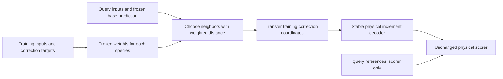

# Signed-increment research results

## Latest: trained fixed-centre local functions

**Valid negative result. GBCT remains the incumbent.** Both distances used the
same 128 centres, 7,424 learned coefficients, 50k training states and work budget.
Unlike the earlier neighbor diagnostic, these models use fixed learned weights
at inference, with no reference-library lookup.

| Predictor | Same-source unseen, 20k | Development, 1,023 |
|---|---:|---:|
| Global-distance local correction | 72.03 / 72.10% | 68.16 / 68.50% |
| Species-distance local correction | 71.49 / 71.62% | 67.81 / 68.06% |
| Continued GBCT | 72.24 / 72.27% | 68.30 / 68.80% |

Values are seed 11 / 12. Species distance did **not** beat global distance here.
On development it repaired 1,081 / 962 base failures, but damaged 1,370 / 1,401
base successes. The global model repaired 585 / 547 and damaged 665 / 728.
Both models introduce negative endpoints and take about 2.41-2.50 times measured
base latency. Neither qualifies. Full nominal-label scoring, state-only replay,
fresh base replay, tail/count/gate recounts and snapshot damage checks passed.
No confirmation data was opened. The four fits used about 55 seconds of recorded
fit time; this is not GPU allocation time.

The neighbor result cannot be treated as a guarantee for a trained local model.
The next registered control keeps this basis and objective fixed and uses 20
full-data convex coefficient updates. It asks whether Adam left useful fitting
work undone. It is additional optimization, not a matched-work architecture test.
See [the experiment](experiments/EXP-20261013-local-optimum.json) and the ledger.

## Previous: species-specific distance diagnostic

**Result: better local information, but no better predictor than the base.**
The continued GBCT models remain the incumbents. The physical acceptance rule
stays `abs(error) <= 1e-15 + 0.1*abs(reference)`.

### What changed

The previous diagnostic used one distance for all 58 species. This test gave
each species its own input weights. The weights came from rank correlations
between inputs and correction targets in 48,976 training-library rows. All 1,024
training query rows were excluded. No unseen-query or development labels were
used to fit the weights. A fixed 10% uniform part kept every input in the metric.

The libraries, query rows, base models and nearest-1 / mean-of-8 rules did not
change. The global-distance control was rerun and reproduced the old neighbor
graphs and physical pass counts. The 10k search also used the fixed 48,976-row
metric calibration; it is not a 10k-total-data experiment.

### Main comparison

This table uses the fixed 50k library. Values are acceptance percentages for
seed 11 / seed 12. The same-source-unseen sample has 2,048 states; development
has all 1,023 states. Neither is independent confirmation.

| Predictor or diagnostic | Same-source unseen | Development |
|---|---:|---:|
| Continued GBCT base | **72.23 / 72.27** | **68.30 / 68.80** |
| Global distance, nearest-1 correction | 57.03 / 57.06 | 55.24 / 55.51 |
| Species rank distance, nearest-1 correction | 60.81 / 60.80 | 58.51 / 58.80 |
| Global distance, mean-of-8 correction | 52.05 / 52.06 | 50.34 / 50.40 |
| Species rank distance, mean-of-8 correction | 61.56 / 61.36 | 59.08 / 58.86 |

All 16 primary correction comparisons improve over their matching global-distance
control: both library sizes, both neighbor rules, both seeds, and both U/D
populations. None beats the base. The [aggregate evidence](results/species-distance-20261013.json)
also includes training queries, full-target transfers, species and snapshot scores.

### What the change fixes, and what it does not fix

For the 50k mean-of-8 development comparison:

| Quantity | Global distance, seed 11 / 12 | Species distance, seed 11 / 12 |
|---|---:|---:|
| Base failures repaired | 2,229 / 2,081 | 2,509 / 2,423 |
| Base successes damaged | 12,883 / 12,997 | 7,979 / 8,321 |
| Normalized-error p99 | 278.33 / 276.12 | 20.55 / 21.12 |
| Negative endpoint components | 1,717 / 1,684 | 871 / 925 |

Thus, the gain mainly comes from **less damage**, with some additional repair.
The p99 error falls by about 92%. Development acceptance improves for 57 and 54
species respectively; one and three decrease, with no decrease over one percentage
point relative to this diagnostic control. This is not a claim of improvement
over the base for those species.

The remaining damage is still too large: 19.69% / 20.38% of base-passing development
components fail after correction. The base has no negative endpoint components
in this population. Species distance still gives 871 / 925. Its weak-increment
acceptance is 40.65% / 40.52%, below the base's 43.86% / 43.88%; active acceptance is
58.51% / 58.26%, also below the base. No complete development state passes all
58 species in either of these two weighted mean-of-8 runs. Better neighbors are
not yet safe corrections. Scores use the existing nominal references; individual
reference qualification remains limited to the earlier audited subsets.

### Interpretation and next action

The tested feature metric was a real limitation of local transfer: changing only
its species-specific weights gives a consistent gain. This supports further work
on input relevance and species-specific structure. It does not prove causality of
individual input features, intrinsic smoothness, or that separate neural heads
will succeed. Marginal rank correlations can miss interactions and nonmonotone
dependence. Some inputs are base-output features, not independent chemical causes.

Do not tune the weight floor on development or deploy label-copying inference.
The next justified comparison is a **trained species-local correction model
against the same model with global distance**, at matched model size and work.
It must learn stored coefficients from training data, not copy reference answers
at inference. Keep the base as the comparator and require repair, preservation,
transfer and cost evidence. Register that model comparison before execution;
it has not been run by this diagnostic.

### Verification and cost

Execution source: `d5aada06`; run: `runs/offline-accuracy/species-distance-20261013`.
Independent NumPy checks reproduced 696 full-library query rankings across 232
species/library/seed graphs. All four global-control graphs match the prior run
exactly. A separate process recounted all 96 physical result records. The old and
new global controls have zero mismatches in pass, base-pass, repair and damage
counts. All predictions were finite. The protected evaluator was unchanged.

The registered run took 217 seconds after admission. Worker wall times were
75.57 and 80.92 seconds; independent checks and scoring took 17.32 and 16.51
seconds. These are diagnostic execution times, not deployment latency or measured
GPU allocation time. There were no neural fits or new chemistry references.
All 94 focused tests run for this change passed. An initial broader test command
omitted GPU-selection and deterministic-CuBLAS environment settings; rerunning
with the documented settings passed without code changes. No experiment retry
was needed. Shared environments and other users' jobs were not modified.

## Earlier: local predictability diagnostic

The continued GBCT models remain the incumbents. This diagnostic does not identify
an improved predictor. No new model was trained or promoted.

### What we did

1. Select 1,024 training queries and 2,048 correction-unseen queries per seed,
   equally sampled across the four training snapshots. Use all 1,023 development
   states. Keep query labels out of the neighbor-search worker.
2. Find neighbors in the fixed 10k and 50k training libraries, using either the
   61 state features or all 119 correction features. Exclude training queries
   from their own neighbor lists. IDs include their dataset namespace.
3. On the same neighbor graph, transfer either the full target coordinate
   `z=asinh(d/1e-14)` or the correction `c=z-asinh(base/1e-14)`.
4. Score the resulting signed increments with the unchanged physical contract.
   Compare nearest-1, the mean of nearest-8, and a shuffled-label control.

These are diagnostic transfers of training information. They are not a deployed
label-lookup rule or a claim about intrinsic smoothness or neural learnability.

### Results

The table shows the fixed 50k library and 119-feature comparison. Each cell is
seed 11 / seed 12, in percent. All registered comparisons are retained in the
[aggregate evidence](results/local-predictability-20261013.json).

| Diagnostic | Same-source unseen sample | Development |
|---|---:|---:|
| Unchanged base | **72.23 / 72.27** | **68.30 / 68.80** |
| Nearest-1 full target | 6.78 / 6.98 | 8.58 / 8.47 |
| Nearest-1 correction | 57.03 / 57.06 | 55.24 / 55.51 |
| Mean of nearest-8 corrections | 52.05 / 52.06 | 50.34 / 50.40 |
| Shuffled nearest-1 correction control | 53.54 / 53.49 | 50.71 / 51.06 |

The unseen sample is 2,048 of the fixed 20k rows. Its base score is not the
full-20k score from the earlier screening table. The development population is
unchanged. Neither population is an independent test.

### Meaning

- There is some local signal: nearest-neighbor corrections outperform shuffled
  corrections by about 4.5 percentage points on development. That does not make
  them an improvement over the base.
- Residual coordinates vary less than full-target coordinates on these graphs.
  Median development coordinate differences are about 0.081-0.082 for corrections,
  versus 1.246-1.248 for full targets. This does **not** support the claim that the
  residual is intrinsically harder merely because it has larger local variation.
- Reusing corrections still causes broad damage. Development repairs/damage are
  2,349/10,093 and 2,277/10,162. About 25% of base-passing components are damaged.
- Averaging eight corrections lowers coordinate-error p99, but increases damage
  to about 32% and reduces physical acceptance. In this slice, active-increment
  acceptance falls from about 54.5% to 48.8%, while weak-increment acceptance rises
  slightly. Less coordinate variation is not the same as better physical accuracy.
- Increasing the library from 10k to 50k only modestly reduces neighbor distance.
  For example, median development distance in the 119-feature space falls from
  about 7.74-7.78 to 7.25-7.30. These dimensionless distances are metric-specific;
  they are not chemical error bounds.

### Decision and next test

Do not deploy nearest-neighbor correction or start a larger local-table sweep.
These fixed global input distances do not identify safely interchangeable
corrections. This does not rule out local models or a different input metric.

The next discriminating question is whether a distance specific to each species
can select chemically relevant neighbors better than one distance shared by all
58 outputs. Compare a training-derived species metric with this fixed global
control before adding model capacity. Keep the same libraries, query populations,
physical contract and no-label inference boundary. This is a proposed next test,
not a demonstrated result or a manual temperature switch.

### Evidence and verification

Run: `runs/offline-accuracy/local-predictability-20261013`; source `e559e371`.
All 144 physical pass/base-pass/repair/damage records were independently recounted.
Independent NumPy searches matched eight fixed queries for each of eight GPU
graphs, including neighbor order. No self IDs were returned. All 112 focused
tests pass. The two-seed diagnostic took about 80 seconds after admission,
including preparation, GPU search and scoring; it is not an inference benchmark.
No neural fit, new chemistry reference, confirmation access or shared-host change
occurred. Full-array reference qualification remains limited to existing audits.

## Earlier: first research-contract screening block

## Decision

Keep the continued GBCT models. No new candidate meets the accuracy and
preservation gates. The research objective is not achieved.

The contract is installed. The saved baseline counts reproduce. Twelve GPU fits
tested six recipes with two seeds each. Independent code recounted their saved
physical predictions. All 107 focused tests pass.

## What was tested

All corrections use a fixed-asinh decoder with crossover 1e-14. The physical rule
remains `abs(error) <= 1e-15 + 0.1*abs(reference)`.

| ID | Recipe | Training states | Head parameters |
|---|---|---:|---:|
| A | Existing features; small head; coordinate Smooth L1 | 10,000 | 177,210 |
| B | A plus 800 frozen-base hidden features | 10,000 | 382,010 |
| C | Existing features; larger head; B's approximate parameter budget | 10,000 | 381,754 |
| P | A plus a penalty for leaving base-passing training intervals | 10,000 | 177,210 |
| L | Existing features; affine correction head | 10,000 | 6,960 |
| S | A with more distinct training states | 50,000 | 177,210 |

Each fit uses 6,000 updates and batches of 10,000 states: 60 million row
presentations. This matches optimizer work, not elapsed time or epochs.

## Physical acceptance

Each cell gives seed 11 / seed 12. Values are percentages, rounded to two decimals.

| Predictor | Candidate training | Same-source, correction-unseen | Development |
|---|---:|---:|---:|
| Continued GBCT base | 72.17 / 72.27 | 72.24 / 72.27 | 68.30 / 68.80 |
| A | 74.16 / 74.39 | 66.12 / 66.10 | 62.71 / 62.36 |
| B | 74.71 / 74.99 | 63.15 / 62.92 | 59.26 / 59.32 |
| C | 76.20 / 76.44 | 59.61 / 59.70 | 55.97 / 55.98 |
| P | 73.86 / 74.38 | 68.96 / 68.24 | 65.20 / 64.34 |
| L | 71.58 / 71.66 | 71.23 / 71.33 | 67.41 / 67.64 |
| S | 71.63 / 71.75 | 71.24 / 71.31 | 67.70 / 67.84 |

The base training cell uses the original 10k subset. On S's 50k subset, the base
scores 72.17% / 72.30%. S's training score has a different population from A-L;
compare transfer on the unchanged unseen and development populations.

The unseen set has 20,000 states per seed. The base saw these states, and feature
calibration used some of them. The correction heads did not train on them. S
explicitly excludes every one of these indices. Development has 1,023 states and
has been inspected repeatedly. Neither population is an independent test.

## What this means, step by step

1. Added features and capacity improve training fit but make transfer worse.
   These tests do not support a larger correction head.
2. The preservation penalty reduces damage but does not produce an improved
   predictor. Training preservation does not ensure unseen preservation.
3. The affine head makes fewer harmful changes but does not repair enough errors.
   Reducing capacity alone is not the solution in this comparison.
4. More distinct states reduce transfer loss. S still damages more base passes
   than it repairs: development repairs/damage are 1,355/1,709 and 1,270/1,842.
   Its damage rates are 4.22% / 4.51%, above the fixed 2% guard.
5. S takes 1.82-1.96 times the measured anchor latency on the fixed 1,023-state
   timing batches. The gate is 1.5 times. These are implementation measurements,
   not lower bounds for the architecture.

The arithmetic can express accurate answers. These recipes have not learned a
correction that repairs and preserves predictions on unseen states. Better
training loss or training acceptance does not establish that result.

## Verification and limits

- All 13 starter-kit manifest hashes match; its 22 synthetic tests pass.
- M0 reproduces saved counts and rejects known regressions and the zero control.
- A reproduces historical training and development predictions exactly.
- S has the same initial weights as A. Only its recipe identifiers and training
  count change. Fixed evaluation states and row IDs remain identical.
- Inference workers receive states and model artifacts, not reference arrays.
  Bubblewrap uses read-only source, model and environment mounts and removes
  network access and host home directories. The controller remains trusted.
- One idle GPU was used. No shared environment or other user's job was changed.
- A controller exit-race interrupted L after a completed fit. Regression tests
  verify the fix. Recovery reused that fit; no completed fit was repeated.
- Recorded training time across 12 fits is about 329 seconds. This excludes
  staging, inference and scoring. Total GPU allocation time was not measured.
  Worker wall time must not be relabelled as GPU allocation time.
- Full-array scores are nominal. The reference audit qualifies a subset, not
  every label. No independent confirmation set or CFD run was used.

The runner is restartable, not an always-on research-agent service. It does not
replace models automatically. A separate confirmation custodian is not set up.

## Next decision

Close these specific feature, capacity and preservation comparisons. Do not run
another loss, width or size sweep from this evidence. The next useful question is
whether nearby states have predictable correction coordinates, or whether the
residual is less regular than the chemistry map itself. A fixed, training-derived
local-predictability diagnostic can distinguish these cases before a new fit.
This is a proposed diagnostic, not a result or an approved new candidate.

## Evidence

Private arrays and weights stay in ignored project `runs/` directories.

| Experiment | Directory under `runs/offline-accuracy/` | Review |
|---|---|---|
| M0 | `research-contract-20261013/m0` | `verification.json` |
| A/B/C | `hidden-features-20261013` | `review.json` |
| P | `preservation-20261013` | `review.json` |
| L | `linear-correction-20261013` | `review.json`, `recovery.json` |
| S | `diversity-20261013` | `control-review.json` |

The [ledger](evidence.jsonl) records hashes and conclusions. The
[experiment manifests](experiments/) record pre-run choices. Start future work
with the [contract index](README.md) and [current state](status.json).
